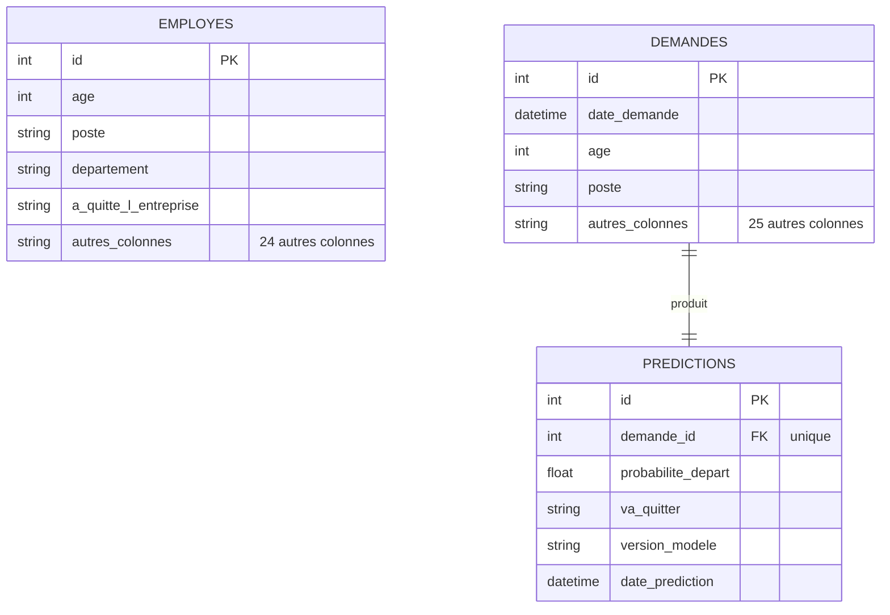

# Schéma de la base de données `attrition`

- **employes** : le dataset d'origine (1 470 lignes), inséré par `create_db.py`.
- **demandes** : les inputs envoyés à l'API, enregistrés **avant** l'appel au modèle.
- **predictions** : les outputs du modèle, reliés à leur demande par la clé étrangère `demande_id`.