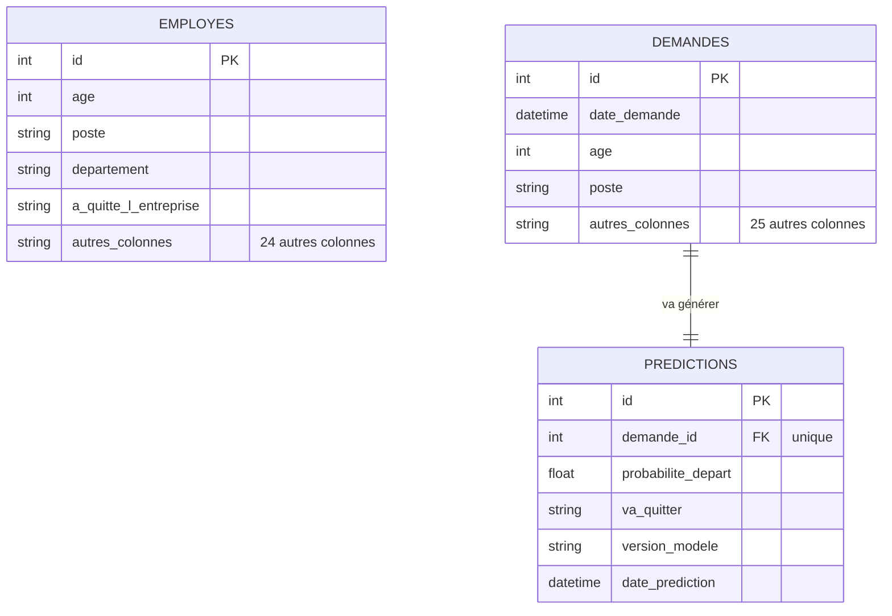

# Schéma de la base de données `attrition`

- employes = le dataset de base avec ses 1 470 lignes -> inséré par `create_db.py`.
- demandes = les INputs envoyés à l'API -> enregistrés avant l'appel au modèle.
- predictions = les OUTputs du modèle -> reliés à leur demande par la clé étrangère `demande_id`.

## Relations et contraintes

**Les relations**
- la table `demandes` vers la table -> `predictions`: Une demande ne va générer qu'une seule prédiction. 
- la table `employes` = la table de référence, elle est donc indépendante et liée à aucune autre table. 

**Les clés**
- Notre Clé primaire (PK) se trouve dans chaque table puisque chacune a une colonne `id`, qui identifie chaque ligne de façon unique.
- Nos Clés étrangères (FK) sont de `predictions.demande_id` vers `demandes.id`.

**2 règles de sécurité: les contraintes**
- `UNIQUE` sur `demande_id` permet d'empêcher d'avoir des doublons. 
- `NOT NULL` permet de ne pas accepter des cases vides. 